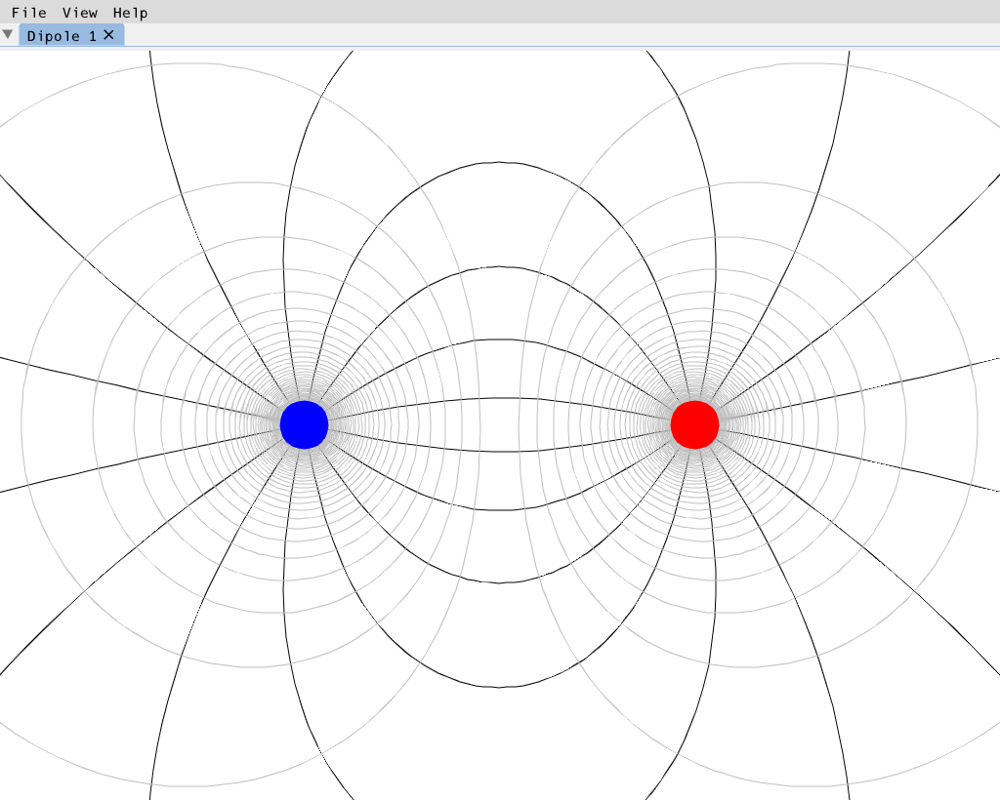

# ElectricField

Electric field lines and equipotentials of point charges, computed with Runge-Kutta methods, including adaptive ones.

A detailed description of the physics is on the computational physics blog: https://compphys.go.ro/electric-field-lines/



This is the cross-platform port of the original MFC application: the same charge configurations produce
the same field lines and equipotentials, but the project now builds and runs on Windows, Linux and macOS
with nothing but [Zig](https://ziglang.org) and its package manager. The original Windows/MFC version is
preserved in history and on the `v1.0` tag.

## Features

- The 9 preset charge configurations of the original app, each opening in its own tab (they can be open side by side and compute in parallel):

| Preset | Charges (+ / -, position x y) |
|---|---|
| Dipole | +1 (-2, 0), -1 (2, 0) |
| Two Equal Charges | +1 (-2, 0), +1 (2, 0) |
| Two Unequal Charges Same Sign | +1 (-2, 0), +2 (2, 0) |
| Two Unequal Charges Different Signs | +2 (-2, 0), -1 (2, 0) |
| Quadrupole | +1 (-1.5, -1.5), -1 (1.5, -1.5), -1 (-1.5, 1.5), +1 (1.5, 1.5) |
| Four Charges Same Sign | +1 (-3, 0), +1 (-1, 0), +1 (1, 0), +1 (3, 0) |
| Two Dipoles Same Direction | +1 (-3, 0), -1 (-1, 0), +1 (1, 0), -1 (3, 0) |
| Two Dipoles Opposed Direction | +1 (-3, 0), -1 (-1, 0), -1 (1, 0), +1 (3, 0) |
| Parallel Dipoles | +1 (-1.5, -1.5), -1 (1.5, -1.5), +1 (-1.5, 1.5), -1 (1.5, 1.5) |

- 11 integration methods: Euler, Midpoint, Ralston, Heun, RK4, RK3/8 and the adaptive Heun-Euler,
  Bogacki-Shampine, Cash-Karp, Fehlberg and Dormand-Prince methods.
- Field lines per unit charge, equipotentials with an adjustable potential interval, a thread count and
  all draw colours/thicknesses in **View > Options...**; the settings persist between runs and draw
  changes repaint the open tabs immediately.
- **Collections**: organise your configurations into collections. A collection is a single file that
  holds named configurations - **File > Open Collection... (Ctrl+O)** opens one with the native file
  picker (from anywhere), **File > New Collection...** creates one through the save dialog, and
  **File > Save Collection / Save Collection As...** write it back (Ctrl+S or a chosen path). The
  **File > Recent Collections** submenu re-opens the files you worked with lately (the list survives
  restarts; when upgrading from an older version the list is seeded from the session pointer's
  collection, and the list is rewritten on quit - current even without a collection switch). The
  **Original** collection (under `Collections\` in the per-user config directory) holds
  the built-in arrangements. The collection you have open appears in the menu bar's switcher; the
  configuration menu entries (New/Open/Save Configuration...) are greyed out until a collection is
  open - the flow is always *open a collection, then work with its configurations*. Nothing is
  auto-opened at startup. A configuration can be removed from its collection with the visible
  **Remove...** button in the configuration chooser (with confirmation; right-clicking the row works
  too).
- **Save Configuration**: a tab opened from a configuration (or saved with **Save Configuration
  As...**) can write its current charges back into that configuration with **File > Save
  Configuration**; the file on disk updates immediately.
- **Charge size**: the drawn radius of the charges scales from a dot to very large (2-120 px) - set
  it in **View > Options** (Draw tab) or with `options.set charge-size`. This is a drawing option
  only; the physics never depends on it. Since v2.6 it is the DEFAULT size for new charges and the
  fallback for charges without a size of their own.
- **Charge editor**: click a charge to select it, drag it with the mouse, nudge it with the arrow keys
  (Shift = bigger steps) or type exact numbers into the editor panel's value/x/y fields with their arrow
  buttons (press and hold to repeat; **+/-** flips the sign). The **New charge** section creates a charge
  with any value and position, double-click empty canvas adds one, Delete removes the selected one.
  Every charge also carries a name and its own drawn size (v2.6): edit both in the panel's **Name**
  and **Size** rows (an empty name shows the derived *Charge N*, which is also what hovering the
  charge on the canvas shows as a tooltip), and the selection ring follows the charge's size. Ids are
  stable and never reused after a removal, even across undo/redo. Rename the tab by typing over its
  name at the top of the panel. Charges move in realtime; the drawn lines keep showing the previous
  calculation (the tab is marked *edited*) until you press **Calculate (F5)** - with a per-tab
  integration method selector in the panel and an optional **Continuous calculation** checkbox that
  recomputes automatically after every edit.
- **Zoom and pan**: the mouse wheel zooms at the cursor, the panel's Zoom - / Zoom + / Reset view buttons
  are always at hand, right-drag pans, and the arrow keys pan whenever no charge is selected. The
  calculation adapts to the view: when you zoom in, the field lines hug the charges (the seed circle
  shrinks to a couple of pixels on screen, floored for numerics) and a settled zoom recalculates
  automatically - no white disk is left around them. The zoom-in ceiling is now about 25x (at the
  ceiling the drawn charge dot exactly covers the floored seed circle; a small charge size in the
  Options lowers it accordingly).
- **Your workspace comes back**: the open tabs - including each tab's calculation method, continuous
  calculation, grid settings and any charge edits - are stored per collection when you quit
  (`Sessions\<Collection>.ini`) and restored when you open the collection again. If tabs have changes
  that are not saved to a collection, a prompt asks before quitting, switching or closing collections.
  **Help > Open Configuration Folder** shows where `options.ini`, `configurations.ini`,
  `session.ini`, `Collections\` and `Sessions\` live.

- Export of the current configuration view to **PNG**, **SVG** and **PDF** (File > Export
  Configuration), matching what is on screen - plus **File > Export Collection...**, which renders
  every configuration of the collection into one PDF: one page per configuration, with the names as
  PDF bookmarks.

- Tabs can be closed while they compute; quitting mid-computation is safe. The computation is cancelled
  within a fraction of a second.

## Building

You need [Zig 0.17](https://ziglang.org/download/) - no other toolchain, no Visual Studio. SDL3 and Dear
ImGui are fetched automatically on the first build.

```sh
zig build          # build everything: the GUI app, ef-cli and the tests
zig build run      # build and start the application
zig build test     # run the unit tests (physics core, app logic, render paths)
zig build smoke    # headless start-up and tab-lifecycle check of the GUI (used by CI)
```

The core, the app logic and `ef-cli` are plain C++17 built with the Zig compiler; `-Dgui=false` builds
only that GUI-free part and fetches no GUI dependency at all.

### Headless command-line modes

```sh
ElectricField --smoke                 # headless GUI start-up check (dummy video driver)
ElectricField --screenshot <slug> <out.png> [--size WxH] [--scale k] [--modal about|chooser]
ElectricField --export <dir>          # export the Dipole as PNG + SVG + PDF (byte-equal to ef-cli's output)
ef-cli --list                         # the 9 preset slugs
ef-cli --preset quadrupole --png q.png --svg q.svg
ef-cli --all --out-dir parity-out --expect tools/parity/expected-counts.csv
```

`ef-cli` renders any preset without a display. CI uses it on Windows, Linux and macOS as a parity oracle:
the committed `tools/parity/expected-counts.csv` pins the number of charges, field lines and
equipotentials per preset, and the GUI's export is checked to be byte-identical to it. The
`docs/baseline/mfc/` images were rendered by the original MFC application and are the visual reference
for the port.

### Command API

Every menu entry and every editor/collection operation is callable through a text command interface
(`docs/api.md` has the full reference). Scripts run the real application headlessly - what a script
does is what a user clicking through the UI does:

```sh
ElectricField --script scenario.efscript --user-dir sandbox --out results.txt
```

```text
# scenario.efscript
collection.new sandbox-collection
tab.new-empty
app.wait-done
charge.move 0 1 0
editor.undo
app.expect charges=1,0,0
collection.save
app.quit
```

`app.state` dumps the full UI state (collection, open tabs, charges, grid, view) and `app.expect`
asserts against it - the same mechanism the CI script tests in `tests/scripts/` use on all three OSes.

## Options and configuration files

Everything lives in the per-user config directory (`SDL_GetPrefPath("ElectricField", "ElectricField")`):

- Windows: `%APPDATA%\ElectricField\ElectricField\`
- Linux: `$XDG_CONFIG_HOME/ElectricField/ElectricField/` (usually `~/.config/...`)
- macOS: `~/Library/Application Support/ElectricField/ElectricField/`

- `options.ini` - computation and draw options; colours as `#RRGGBB`, the integration method by name
  (`euler`, `midpoint`, `ralston`, `heun`, `rk4`, `rk3per8`, `adaptive-heun-euler`,
  `adaptive-bogacki-shampine`, `adaptive-cash-karp`, `adaptive-fehlberg`, `adaptive-dormand-prince`).
  A missing or invalid file falls back to the defaults per setting.
- `configurations.ini` - the pre-collections user configurations (kept for reference; imported into the
  Original collection on first run of v2.2 or later).
- `Collections\<Name>.ini` (or any path you pick) - a COLLECTION FILE: sections [configuration "Name"]
  with `charge = value, x, y, sizePx, id, name` lines (since v2.6 each charge also stores its own
  drawn radius, stable id and editable name; legacy 3-field lines still load - size 0 = the Options
  default, no id, derived name). The file you have open is the working collection;
  **File > Save Collection / Save Collection As...** write it. `options.ini` also stores `chargeSize`
  (v2.5): the drawn charge radius, 2-120 px.

- `session.ini` - a pointer to the last-opened collection plus the recently opened collection files
  (`recent` lines, the Recent Collections menu); the open tabs of each collection live in
  `Sessions\<Collection>.ini` (title, preset source, per-tab method, continuous-calculation flag,
  grid settings, charges - each with its size, id and name since v2.6) and are restored when that
  collection is opened.

## Project layout

- `src/core/ef/` - the physics and scene core (std-only): field/potential, Runge-Kutta integrators,
  seeds and tracers, compute sessions, scene building, SVG backend.
- `src/app/` - GUI-free application logic: the tab model over compute sessions, pure UI decisions, the
  options/configuration/session models, the editor rules.
- `src/render/` - Dear ImGui painter and the offscreen PNG export shared by the GUI and `ef-cli`.
- `src/gui/` - the SDL3 + Dear ImGui application (window, menus, tabs, canvas, dialogs).
- `src/cli/` - `ef-cli`, the headless renderer and CI parity oracle.
- `tests/`, `tests_gui/` - doctest suites (the GUI-free ones run without any display or GUI dependency).
- `tools/parity/` - the committed line-count expectations.
- `assets/` - application icons.

## CI

Every push is built and tested on `windows-x64`, `linux-x64` and `macos-arm64`, plus a Linux
ThreadSanitizer job. The pipeline runs the unit tests, the headless GUI smoke, the 9-preset parity check,
a screenshot/export comparison against the `ef-cli` oracle and a guard that keeps the tree free of the
old MFC/Win32/GDI code.

## Credits

- Original application and physics: Adrian Roman (https://compphys.go.ro/electric-field-lines/)
- Cross-platform port: Johannes Maria Frank (https://github.com/jmfrank63/ElectricField)

Licensed under the GNU General Public License v3.0 - see [LICENSE](LICENSE).

## Editor details (v2.3)

- **Collections in the title**: the window title shows the collection you are working in, plus the active
  tab.
- **Removing configurations**: right-click a configuration in the New chooser to remove it from the
  collection (with confirmation; open tabs are not affected).
- **Esc reverts**: while a tab shows the *edited* marker, Esc restores the charges of the last
  calculation. **Edit > Undo (Ctrl+Z) / Redo (Ctrl+Y)** steps through charge and method changes.
- **Grid**: the panel's Grid section enables snapping and/or drawing independently, switches between
  Cartesian and polar grids and an intersections-only display, and lets you place the grid origin and
  set the spacing. Grid lines are light green; intersection dots (when shown) are a distinct colour.
  With snapping on, dragged, added and typed positions land on the grid.
